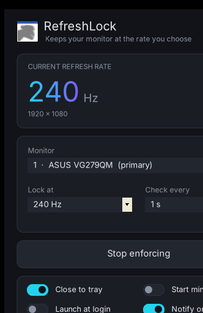

<p align="center">
  
</p>

<h1 align="center">RefreshLock</h1>

<p align="center">A tiny Windows tray app that locks your monitor at the refresh rate you choose — and snaps it back the instant anything changes it.</p>

<p align="center">
  
</p>

## Why

Some setups randomly drop the refresh rate (to 60 Hz, 49 Hz, whatever) and Windows Settings / NVIDIA Control Panel can't make it stick. RefreshLock watches the display and forces your chosen rate back immediately.

## Features

- **Instant correction:** reacts to Windows' display-change event, with a polling timer (0.25–5 s) as backup
- **Live readout** of current refresh rate and resolution, with a status pill (Locked / Not offered / Paused)
- **Multi-monitor:** pick which display to lock
- **Rate list from your hardware:** only shows rates Windows actually offers at your current resolution
- **Close to tray**, start minimized, launch at login, optional notification on each fix
- **Correction counter**, so you can see how often (and from what rate) it's dropping
- Single ~58 KB exe, no install, no dependencies beyond the .NET Framework built into Windows 10/11

## Download

Grab `RefreshLock.exe` from the [latest release](../../releases/latest) and run it.

> The exe is unsigned, so SmartScreen may warn on first launch: click **More info → Run anyway**. Or build it yourself (below).

## Usage

1. Pick your monitor and the rate to lock at (e.g. 240 Hz).
2. Leave it enforcing. Close the window and it lives in the tray.
3. Tray icon: **left-click** to show/hide, **right-click** for Enforcing / Force now / Exit.

Settings are saved to `%APPDATA%\RefreshLock\settings.ini`. "Launch at login" adds an entry under `HKCU\...\Run`.

## Build from source

No Visual Studio needed. The C# compiler ships with Windows:

```bat
C:\Windows\Microsoft.NET\Framework64\v4.0.30319\csc.exe /target:winexe /win32icon:app.ico /optimize+ /r:System.Windows.Forms.dll /r:System.Drawing.dll RefreshLock.cs
```

## Troubleshooting

**Status says "240 Hz not offered".** The GPU has dropped that mode entirely, so no app can force it. Usual causes:

- A bad EDID mode the driver falls back to. Use [CRU (Custom Resolution Utility)](https://www.monitortests.com/forum/Thread-Custom-Resolution-Utility-CRU) to delete the unwanted modes, then run its `restart64.exe`.
- Cable or port bandwidth. Use DisplayPort or a certified high-speed HDMI cable.
- Windows 11 "Dynamic refresh rate" enabled in Settings → Display → Advanced display.

## License

MIT
